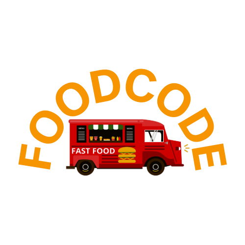
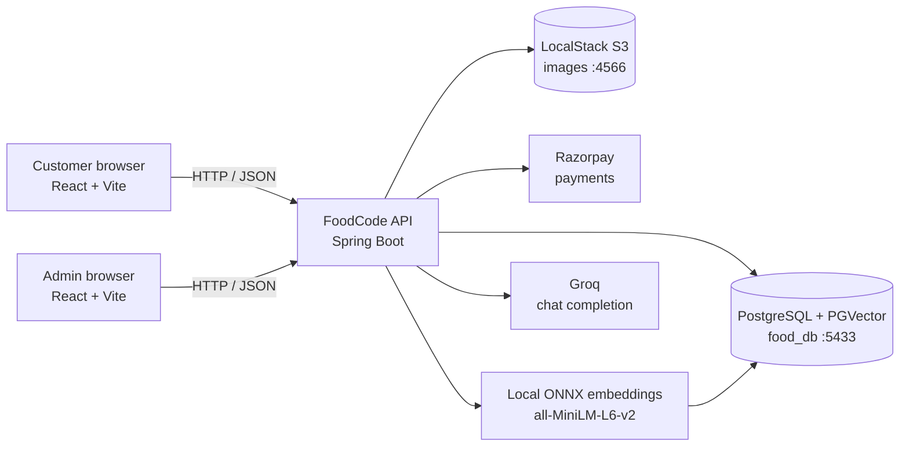
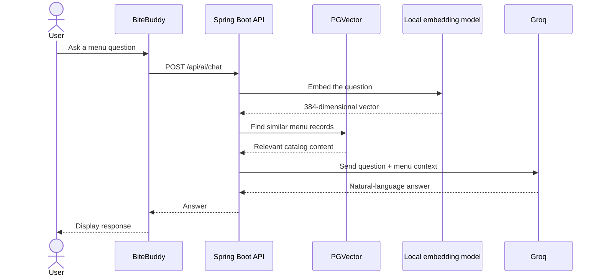

# FoodCode

> A full-stack food ordering app with a friendly AI assistant for choosing what to eat.

FoodCode brings the usual food-ordering journey into one place: browse the menu, add items to a cart, place an order, and get delivery updates. The customer experience is powered by React, the API is built with Spring Boot, and **BiteBuddy** uses menu-aware AI recommendations instead of generic answers.

<p align="center">
  
</p>

<p align="center">
  <strong>Discover something delicious. Order it in a few clicks.</strong>
</p>

---

## What you can do with FoodCode

| Customer experience | Admin experience |
| --- | --- |
| Browse food by category | Add and manage food items |
| View item details and prices | Upload food images |
| Add items to a cart | Review incoming orders |
| Register and sign in | Update order status |
| Place orders with Razorpay | Track the restaurant workflow |
| Ask BiteBuddy for recommendations | Keep the catalog available to the AI assistant |

### Meet BiteBuddy

BiteBuddy is the floating assistant in the bottom-right corner of the customer app. It searches the FoodCode menu first, then asks Groq to turn the relevant menu information into a short, natural response.

It can help with questions such as:

- “What vegetarian dishes do you recommend?”
- “What would be good for a quick lunch?”
- “Which items are in the pizza category?”

The assistant is grounded in the catalog, so it is designed not to invent menu prices, ingredients, or availability.

---

## A quick look at the architecture



### How BiteBuddy answers a question



---

## Project structure

```text
FoodCode/
├── Foodapi/       # Spring Boot REST API, authentication, orders, AI
├── foodcoder/     # Customer-facing React application
├── adminpanel/    # Admin React application
├── docker-compose.yml
└── README.md
```

### Main technologies

- **Backend:** Java 21, Spring Boot 4, Spring Data JPA, Spring Security
- **Customer UI:** React 19, Vite, Bootstrap, Bootstrap Icons
- **Admin UI:** React 19, Vite, Bootstrap
- **Database:** PostgreSQL 16 with the `vector` extension
- **AI search:** Spring AI, PGVector, local ONNX `all-MiniLM-L6-v2` embeddings
- **AI chat:** Groq through its OpenAI-compatible API
- **Storage:** LocalStack S3 for local image storage
- **Payments:** Razorpay

---

## Run FoodCode locally

### Prerequisites

Install the following before starting:

- Java 21
- Node.js and npm
- Docker Desktop
- A Groq API key
- Razorpay test-mode credentials if you want to test checkout

### 1. Start PostgreSQL with PGVector

From the repository root:

```powershell
docker compose up -d postgres
```

The Docker database is available at:

```text
Host: localhost
Port: 5433
Database: food_db
Username: postgres
Password: postgres
```

The PostgreSQL data is stored in the named Docker volume `foodcode-postgres-data`. Starting or stopping the container does not remove that volume.

### 2. Start LocalStack for images

FoodCode expects LocalStack S3 at:

```text
http://localhost:4566
```

If your existing LocalStack container is stopped, start it using the LocalStack setup you already use locally. The application expects the bucket name `foodcode`.

### 3. Configure the backend

Create a local file at `Foodapi/.env`:

```properties
GROQ_API_KEY=replace_with_a_new_key
GROQ_BASE_URL=https://api.groq.com/openai/v1
GROQ_CHAT_MODEL=openai/gpt-oss-20b

SPRING_DATASOURCE_URL=jdbc:postgresql://localhost:5433/food_db
SPRING_DATASOURCE_USERNAME=postgres
SPRING_DATASOURCE_PASSWORD=postgres

JWT_SECRET=replace_with_a_long_random_secret

RAZORPAY_KEY=your_razorpay_test_key
RAZORPAY_SECRET=your_razorpay_test_secret
```

Keep this file local. Never commit API keys, payment secrets, database passwords, or JWT secrets.

Start the API:

```powershell
Set-Location Foodapi
.\mvnw.cmd spring-boot:run
```

The backend runs at:

```text
http://localhost:8080
```

### 4. Start the customer app

Open a second terminal:

```powershell
Set-Location foodcoder
npm install
npm run dev
```

Open:

```text
http://localhost:5173
```

### 5. Start the admin app

Open another terminal:

```powershell
Set-Location adminpanel
npm install
npm run dev
```

Vite will show the admin URL in the terminal, normally:

```text
http://localhost:5174
```

---

## Useful API routes

| Route | Purpose |
| --- | --- |
| `POST /api/register` | Create a customer account |
| `POST /api/login` | Sign in and receive a JWT |
| `GET /api/foods` | Browse the catalog |
| `POST /api/ai/chat` | Ask BiteBuddy a menu question |
| `POST /api/cart` | Add or update cart items |
| `POST /api/orders` | Create an order |
| `POST /api/orders/verify` | Verify a Razorpay payment |
| `GET /api/orders/myorders` | View the signed-in customer’s orders |

The AI route is public. Cart and order routes require authentication.

---

## Looking at the database

Connect with pgAdmin, DBeaver, or another PostgreSQL client using:

```text
Host: localhost
Port: 5433
Database: food_db
Username: postgres
Password: postgres
```

Important tables include:

- `foodstore` — menu items
- `users` — registered users
- `carts` — active carts
- `orders` — customer orders
- `vector_store` — searchable AI menu documents and embeddings

The `vector_store` table is derived data. It can be rebuilt from the menu catalog and does not replace the original `foodstore` records.

---

## Development commands

### Backend

```powershell
Set-Location Foodapi
.\mvnw.cmd -DskipTests compile
```

### Customer frontend

```powershell
Set-Location foodcoder
npm run build
```

### Admin frontend

```powershell
Set-Location adminpanel
npm run build
```

---

## Notes for contributors

- Keep credentials in `Foodapi/.env`; do not put them in Java, React, Docker Compose, or README files.
- The customer app talks to the API on port `8080`.
- The Docker PostgreSQL container uses host port `5433` so it can coexist with a local PostgreSQL installation on port `5432`.
- Local ONNX embeddings are cached under the user home directory and are separate from Groq chat generation.
- Run the frontend build after changing customer UI or BiteBuddy behavior.

## License

This project is currently maintained as a personal development project. Add a license here when you decide how you want others to use and distribute the code.
